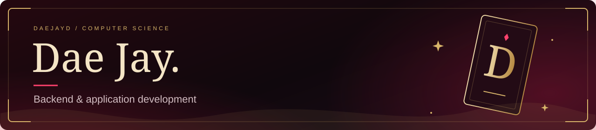
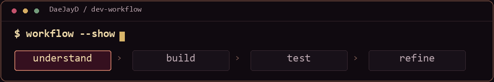
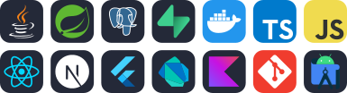

  

  
  &nbsp;
  

I'm a **Computer Science student in Cagayan de Oro, Philippines**, building web and Android apps. My focus is backend and application development: APIs, databases, and the interfaces that connect them to people.

<picture>
  <source media="(prefers-reduced-motion: reduce)" srcset="./assets/about-static.png" />
  
</picture>

## Current projects

### <a href="https://github.com/DaeJayD/FastPas-POS"> &nbsp;FastPas POS ↗</a>

A mobile retail app bringing **sales, inventory, staff, and reporting** into one workflow. Currently improving its retail flows and backend structure.

FLUTTER · DART · SUPABASE &nbsp; / &nbsp; IN DEVELOPMENT

### <a href="https://github.com/DaeJayD/Ryser-Alarm"> &nbsp;Ryser Alarm ↗</a>

An Android alarm app with **wake-up missions, follow-up checks, and local wake history**. Built with Flutter and native Kotlin alarm handling.

FLUTTER · DART · KOTLIN &nbsp; / &nbsp; IN DEVELOPMENT

### <a href="https://dsportfolio-sigma.vercel.app"> &nbsp;D' Arcana Archives ↗</a>

My portfolio, where **tarot cards, crimson fog, and interactive project pages** introduce the work behind the visuals.

NEXT.JS · REACT · TYPESCRIPT &nbsp; / &nbsp; LIVE PORTFOLIO

## Stack

**Backend & data** — Java, Spring Boot, PostgreSQL, Supabase 
**Web & mobile** — React, Next.js, TypeScript, Flutter, Dart, Kotlin 
**Development** — Git, Docker, Android Studio

## Currently exploring

I'm exploring how AI and automation can reduce repetitive work and connect business tools.

- **AI workflows** — using LLM APIs for summaries, data extraction, and task assistants.
- **Sales funnels & CRM automation** — connecting lead capture, qualification, follow-ups, and appointment booking.
- **Work automation** — connecting apps through APIs and webhooks for reporting, data syncing, and notifications.

Tools on my learning list: **n8n, Make, Zapier, and GoHighLevel**.

## GitHub activity

  

## Get in touch

For internships, collaborations, or project inquiries: **[donos.daejay11@gmail.com](mailto:donos.daejay11@gmail.com?subject=Hello%20Dae%20Jay)**.

Some client work is private. Where permitted, I can share sanitized screenshots, walkthroughs, and technical explanations.

  

